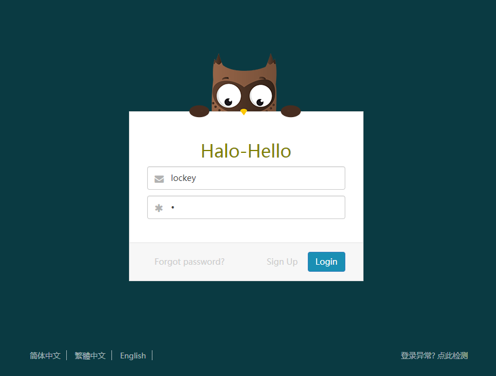
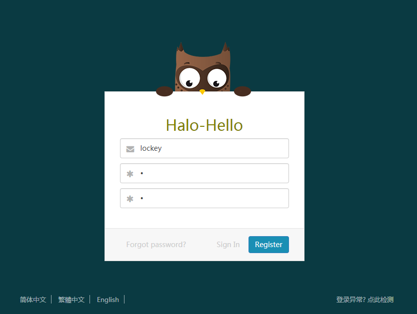
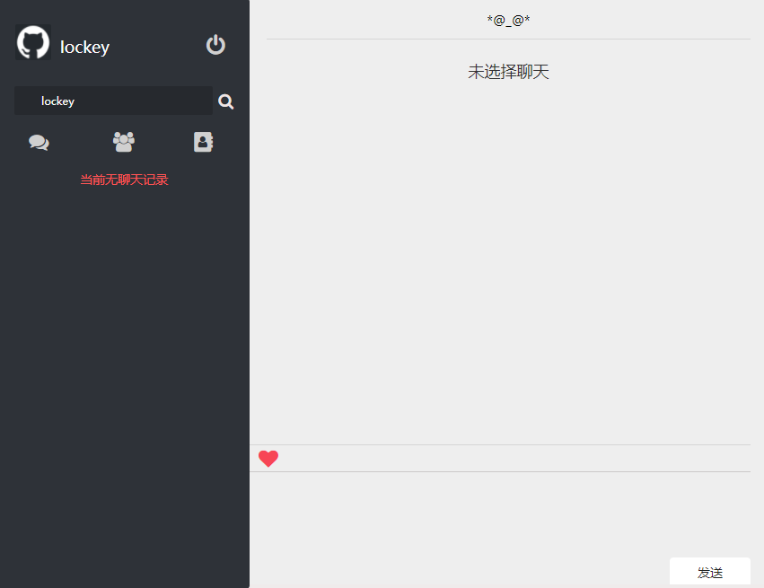
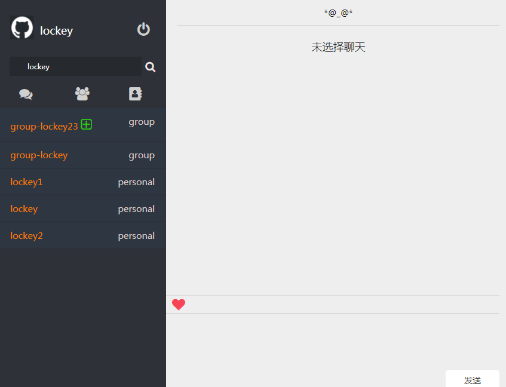
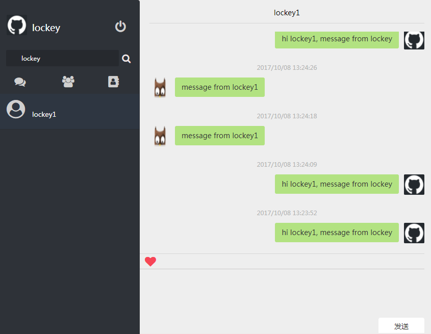
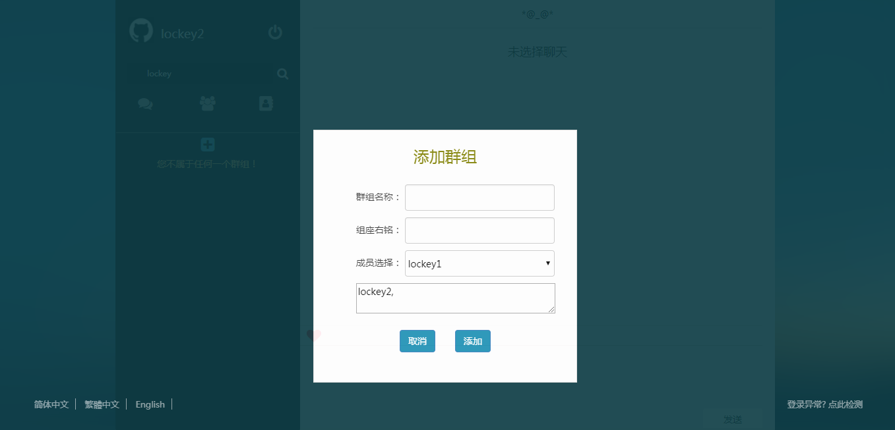
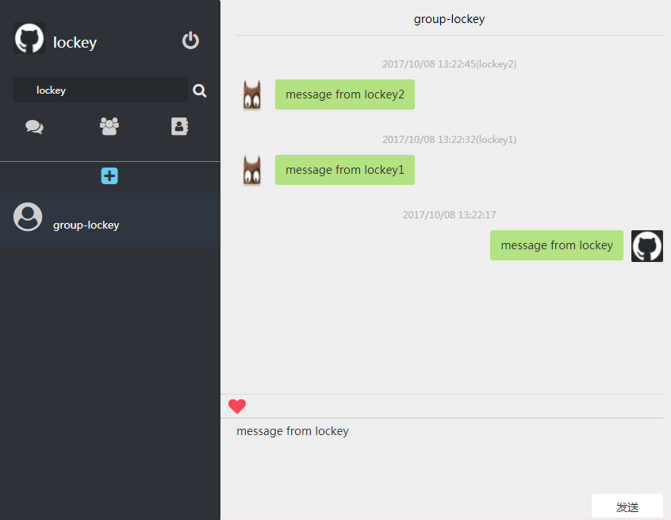

# Online Chatting
**--An online chatting aplication based on websocket && python socket**

**following links are pictures match the title**

### User Guide

1. Start simple python socket as server: pythonx websockt-server.py
2. open web page halo-hello.html
3. register new user if no one/login with existing user/password
4. search user to start a chat

### register

### login success

### search && result

### p2p chatting

### group add

### group chatting

